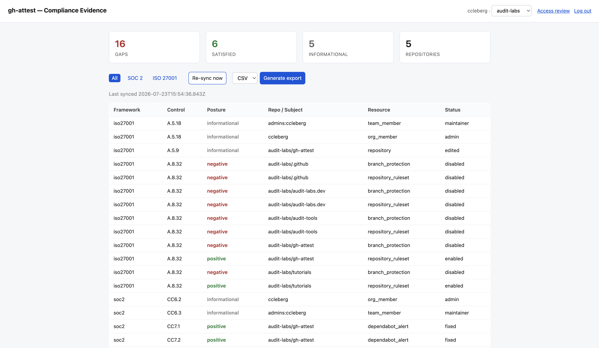

# gh-attest

[](https://sonarcloud.io/summary/new_code?id=audit-labs_gh-attest)
[](https://sonarcloud.io/summary/new_code?id=audit-labs_gh-attest)
[](https://sonarcloud.io/summary/new_code?id=audit-labs_gh-attest)
[](https://sonarcloud.io/summary/new_code?id=audit-labs_gh-attest)
[](LICENSE)

Turns GitHub security settings into auditor-ready evidence. A self-hosted
GitHub App that records branch protection, scanning alerts, and organization
access as they change, maps them to SOC 2 and ISO 27001 controls, and exports
point-in-time CSV and PDF evidence packages.

You register your own GitHub App and deploy the Worker to your own Cloudflare
account. Audit Labs does not run a hosted instance.

Read-only — it never modifies your repositories, permissions, or membership.



## What it collects

| Signal | Evidence for |
| --- | --- |
| Branch protection, repository rulesets | SOC 2 CC8.1 · ISO 27001 A.8.32 |
| Secret scanning alerts | SOC 2 CC6.1, CC6.6 · ISO 27001 A.5.17 |
| Dependabot alerts | SOC 2 CC7.1 · ISO 27001 A.8.8 |
| Code scanning alerts | SOC 2 CC7.1 · ISO 27001 A.8.28, A.8.29 |
| Organization / team membership | SOC 2 CC6.2, CC6.3 · ISO 27001 A.5.18 |
| Repository inventory | ISO 27001 A.5.9 |

Mappings live in `migrations/` and are applied as a join at query time, so a
mapping can be corrected without re-ingesting history. Every mapping — and the
plain-language rationale for why each signal is evidence for its control — is
documented in [docs/framework-mapping.md](docs/framework-mapping.md).

## How it works

Webhooks capture changes as they happen; an hourly cron polls for state that
webhooks never announce (protection and open alerts that predate the install,
whether each scanner is enabled, and current membership). Each observation is stored as a timestamped snapshot in D1.
Exports render off the request path via a queue, into R2.

**Stack:** Cloudflare Workers · D1 · R2 · Queues. The deployment steps below
create all storage under Cloudflare's `eu` jurisdiction.

Installations are recorded only from the App's webhooks; the hourly poll covers
installations already recorded and does not discover new ones. If the webhook
URL or secret is wrong, every delivery is refused with a 401 and the
installation never appears.

## Endpoints

Routes served by a deployed Worker:

| Route | Auth | Purpose |
| --- | --- | --- |
| `GET /` | session | Dashboard: current posture, exports |
| `GET /access-review` | session | Membership changes since a date |
| `POST /exports`, `/resync`, `/switch`, `/exclusions` | session | Dashboard actions |
| `GET /exports/:id[/download]` | session | Export status / file |
| `POST /webhooks/github` | HMAC | App events |
| `POST /webhooks/marketplace` | HMAC | Marketplace events |
| `POST /admin/{poll,export,cleanup,purge}` | bearer | Operations |

Session routes are scoped by installation; admin routes require `ADMIN_TOKEN`.

Repositories can be excluded from the dashboard: an excluded repo is skipped by
the poll and contributes no evidence, while its existing history is retained so
the exclusion can be undone.

## Development

```sh
npm install
cp .dev.vars.example .dev.vars   # fill in, see below
npm run db:migrate:local
npm run dev
```

Type checking: `npm run typecheck`. Generate binding types after editing
`wrangler.jsonc`: `npm run types`.

## Deployment

Create the storage. Jurisdiction is fixed at creation:

```sh
npx wrangler d1 create gh-attest-db-eu --jurisdiction eu
npx wrangler r2 bucket create gh-attest-exports-eu --jurisdiction eu
npx wrangler queues create generate-export
```

Put the `database_id` printed by `d1 create` into `wrangler.jsonc`, then:

```sh
npm run db:migrate:remote
npm run deploy
```

Register a GitHub App with:

| Setting | Value |
| --- | --- |
| Webhook URL | `https://<worker>/webhooks/github` |
| Webhook secret | same value as `GITHUB_WEBHOOK_SECRET` |
| Callback URL | `https://<worker>/callback` |
| Repository permissions (read-only) | Administration, Metadata, Dependabot alerts, Code scanning alerts, Secret scanning alerts |
| Organization permissions (read-only) | Members |
| Events | Branch protection rule, Repository ruleset, Dependabot alert, Code scanning alert, Secret scanning alert, Member, Organization, Team, Repository, Push |

Install it on your organization, then confirm the `installation` delivery
returned 200 under the App's Advanced → Recent Deliveries.

Secrets are set with `wrangler secret put <NAME>` — never in `wrangler.jsonc`:

| Secret | Purpose |
| --- | --- |
| `GITHUB_APP_ID`, `GITHUB_APP_PRIVATE_KEY` | Mint installation tokens |
| `GITHUB_WEBHOOK_SECRET` | Verify webhook signatures |
| `GITHUB_APP_CLIENT_ID`, `GITHUB_APP_CLIENT_SECRET` | Dashboard OAuth |
| `SESSION_SECRET` | Sign session cookies |
| `ADMIN_TOKEN` | Bearer for `/admin/*` |

Pipe the private key from its file rather than pasting it:
`wrangler secret put GITHUB_APP_PRIVATE_KEY < key.pem`

> Cron triggers occasionally stop firing after a deploy. If the hourly poll
> goes quiet, set `triggers.crons` to `[]`, deploy, restore it, and deploy
> again — a same-value redeploy does not clear it.

## Data handling

Evidence is retained for 13 months and exports for 90 days; everything for an
installation is deleted when the App is uninstalled. No source code or access
tokens are stored. See [PRIVACY.md](PRIVACY.md).

Retention periods are defined in `src/index.ts` and restated in `PRIVACY.md` —
change both together.

## License

GPL-3.0. See [LICENSE](LICENSE).
